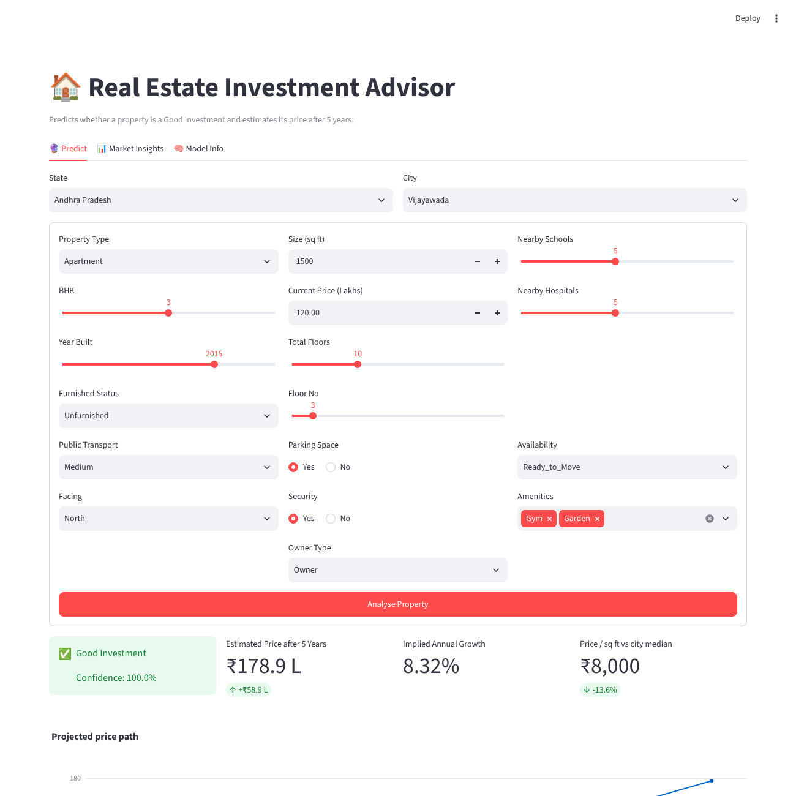
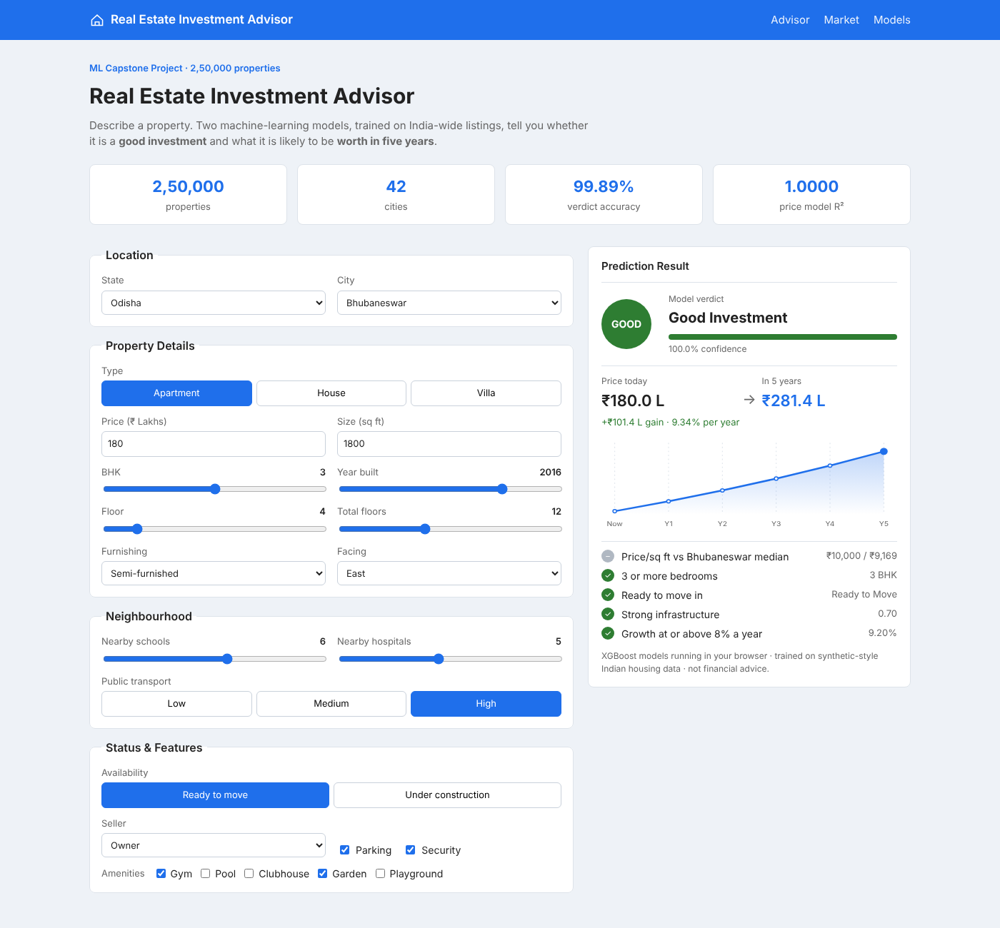
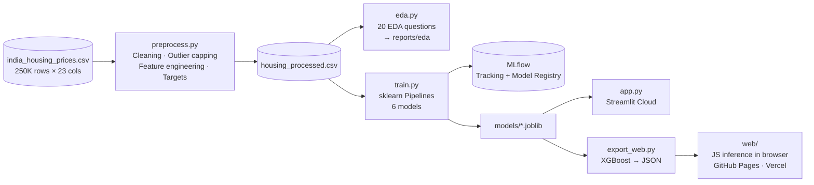
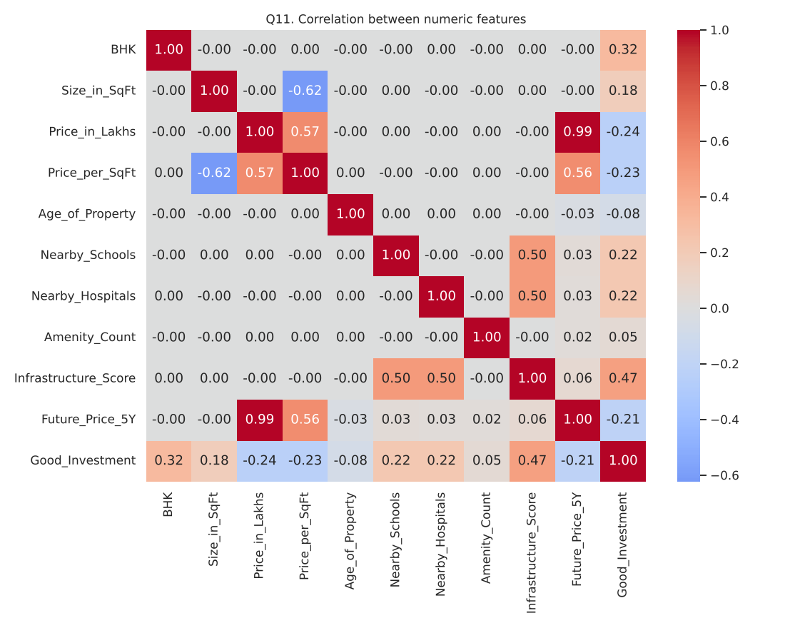
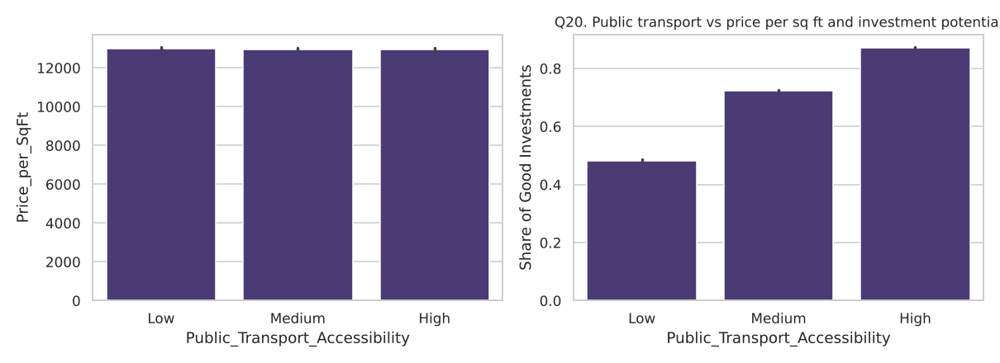

<div align="center">

# 🏠 Real Estate Investment Advisor
### Predicting Property Profitability & Future Value with Machine Learning

[](https://real--estate-advisor.streamlit.app/)
[](https://ankit-builds1.github.io/real-estate-investment-advisor/)
[](https://real-estate-investment-advisor.vercel.app)
<br/>


**An end-to-end ML system that tells an investor whether a property is a _Good Investment_ (classification) and what it will be worth in _5 years_ (regression). It is trained on 250,000 Indian housing records, tracked with MLflow and deployed in three places.**

</div>

---

## 🚀 Live Deployments

| Platform | Link | What it is |
|---|---|---|
| **Streamlit Cloud** | **https://real--estate-advisor.streamlit.app/** | Main project app: prediction form, market insights, model info |
| **GitHub Pages** | **https://ankit-builds1.github.io/real-estate-investment-advisor/** | Static web app; the XGBoost models run directly in the browser |
| **Vercel** | **https://real-estate-investment-advisor.vercel.app** | Same web app, mirrored on Vercel |

> **Note:** Some Indian networks (e.g. Jio) block `*.vercel.app`. If that link doesn't open, use the GitHub Pages or Streamlit link.

<p align="center">
  
  
</p>

---

## 📌 Table of Contents
1. [Problem Statement](#-problem-statement)
2. [Key Results](#-key-results)
3. [System Architecture](#-system-architecture)
4. [Dataset](#-dataset)
5. [Methodology](#-methodology)
6. [Exploratory Data Analysis](#-exploratory-data-analysis)
7. [Model Training & MLflow](#-model-training--mlflow)
8. [Applications](#-applications)
9. [Project Structure](#-project-structure)
10. [Run Locally](#-run-locally)
11. [Deployment Guide](#-deployment-guide)
12. [Limitations & Future Work](#-limitations--future-work)
13. [Author](#-author)

---

## 🎯 Problem Statement

Real estate investors need data-backed answers to two questions before buying:

1. **Is this property a good investment?** → *Binary classification* (`Good_Investment`: 1/0)
2. **What will it be worth in 5 years?** → *Regression* (`Future_Price_5Y` in ₹ Lakhs)

**Business use cases**
- ✅ Help investors assess long-term returns
- ✅ Help buyers find high-return properties in developing areas
- ✅ Let real estate platforms automate investment analysis for their listings
- ✅ Build customer trust with transparent, data-backed predictions

---

## 🏆 Key Results

Evaluated on a **20% held-out test set (50,000 properties)**.

### Classification: Good Investment
| Model | Accuracy | F1 | Precision | Recall | ROC-AUC |
|---|---|---|---|---|---|
| Logistic Regression | 0.8748 | 0.9107 | 0.9001 | 0.9216 | 0.9425 |
| Random Forest | 0.9838 | 0.9884 | 0.9837 | 0.9931 | 0.9985 |
| **XGBoost** ✅ | **0.9989** | **0.9992** | **0.9991** | **0.9993** | **1.0000** |

**Confusion matrix (XGBoost):**

|  | Predicted: Not Good | Predicted: Good |
|---|---|---|
| **Actual: Not Good** | 15,319 | 31 |
| **Actual: Good** | 23 | 34,627 |

→ Only **54 errors out of 50,000** predictions.

### Regression: Price after 5 Years (₹ Lakhs)
| Model | RMSE | MAE | R² |
|---|---|---|---|
| Linear Regression | 11.98 | 9.01 | 0.9970 |
| Random Forest | 3.20 | 2.29 | 0.9998 |
| **XGBoost** ✅ | **1.24** | **0.99** | **≈1.0000** |

→ An average error of under **₹1 Lakh** on properties priced up to ₹500 Lakhs today.

### Most important features
| Good Investment (classifier) | Future Price (regressor) |
|---|---|
| BHK · Ready-to-Move status · Infrastructure Score · Price per SqFt · Age of Property | Current Price · Ready-to-Move status · Infrastructure Score · Age · Villa type |

---

## 🧭 System Architecture



---

## 📊 Dataset

**Source:** `india_housing_prices.csv` (provided by Labmentix): **250,000 properties**, **23 features**, **20 states**, **42 cities**, **500 localities**.

| Group | Columns |
|---|---|
| Location | State, City, Locality |
| Property | Property_Type, BHK, Size_in_SqFt, Price_in_Lakhs, Price_per_SqFt, Year_Built, Age_of_Property, Furnished_Status, Floor_No, Total_Floors, Facing |
| Neighbourhood | Nearby_Schools, Nearby_Hospitals, Public_Transport_Accessibility |
| Features | Parking_Space, Security, Amenities |
| Ownership | Owner_Type, Availability_Status |

**Data quality:** 0 missing values and 0 duplicates. 19,723 IQR outliers in price per sq ft, capped at the 1st–99th percentile.

---

## 🔬 Methodology

### 1. Data preprocessing (`src/preprocess.py`)
- Handles missing values (median for numeric columns, mode for categorical) and drops duplicates
- Recomputes `Price_per_SqFt` in ₹ (the raw file stored it in lakhs)
- Detects outliers with the IQR rule and caps them at the 1st–99th percentile (no rows are dropped)
- Scales features with `StandardScaler` and encodes categories with `OneHotEncoder`, both inside an sklearn `Pipeline`, so training and inference use identical transformations

### 2. Feature engineering (`src/features.py`)
| Feature | Formula / logic |
|---|---|
| `School_Density_Score` | Nearby_Schools / 10 |
| `Hospital_Density_Score` | Nearby_Hospitals / 10 |
| `Infrastructure_Score` | mean(school score, hospital score, transport level), scaled 0–1 |
| `Amenity_Count` + `Has_Gym/Pool/Clubhouse/Garden/Playground` | parsed from the Amenities text |
| `Parking_Flag`, `Security_Flag` | Yes/No → 1/0 |
| `Floor_Ratio` | Floor_No / Total_Floors |

> The brief mentions *crime rate* and an *infrastructure score*, but neither column exists in the dataset. `Infrastructure_Score` is built from schools, hospitals and transport as a location-quality proxy.

### 3. Target creation
The dataset has no future prices or investment labels, so both targets are created with the domain rules suggested in the project brief.

**`Future_Price_5Y` (regression):** feature-based compound growth

$$\text{Future} = \text{Price} \times (1 + r)^5$$

where **r = 8% base**, adjusted for infrastructure (±2%), under construction (+1%), age > 25 years (−1%), amenities (+0.2% each) and villas (+0.5%).

**`Good_Investment` (classification):** a multi-factor score, with 1 point for each of:
1. Price per sq ft ≤ the city median
2. BHK ≥ 3
3. Ready to move
4. Infrastructure score ≥ 0.5
5. Expected growth ≥ 8%

**Score ≥ 3 → Good Investment** (69.3% of properties).

---

## 📈 Exploratory Data Analysis

`src/eda.py` answers all **20 EDA questions** from the brief and saves one chart per question to `reports/eda/`. The written answers are in [`reports/EDA_findings.md`](reports/EDA_findings.md).

| # | Area | Questions |
|---|---|---|
| 1–5 | Price & size | Price and size distributions, price/sqft by type, size vs price, outliers |
| 6–10 | Location | Price/sqft by state, price by city, property age by locality, BHK by city, top-5 locality trends |
| 11–15 | Correlations | Correlation heatmap; schools, hospitals, furnishing and facing vs price |
| 16–20 | Investment | Owner type, availability, parking, amenities, public transport vs investment |

**Key insights**
- 🚇 **Public transport is the strongest investment signal:** the Good Investment share rises from **48% (Low) → 72% (Medium) → 87% (High)**.
- 🏗️ **Ready-to-move properties are much safer:** 80% are good investments vs 58% of under-construction ones.
- 🛏️ **3+ BHK homes** are rated good **83%** of the time, vs 48% for 1–2 BHK.
- 📏 Size and price are almost uncorrelated (r ≈ 0), so price per sq ft varies widely.
- 🗺️ State and city averages differ by **only ~3%**: the dataset is evenly spread across India.

<p align="center">
  
  
</p>

---

## 🧪 Model Training & MLflow

`src/train.py` trains **6 models** with a stratified 80/20 split:

| Task | Models |
|---|---|
| Classification | Logistic Regression · Random Forest · **XGBoost** |
| Regression | Linear Regression · Random Forest · **XGBoost** |

**MLflow integration**
- Every run logs its **parameters, metrics, confusion matrix and the full sklearn pipeline**
- Two experiments: `Good_Investment_Classification` and `Future_Price_Regression`
- The best models are **registered in the MLflow Model Registry** as:
  - `RealEstate_GoodInvestment_Classifier`
  - `RealEstate_FuturePrice_Regressor`

```bash
mlflow ui --backend-store-uri sqlite:///mlflow.db   # → http://localhost:5000
```

---

## 💻 Applications

### Streamlit app (`app.py`)
| Tab | Features |
|---|---|
| 🔮 **Predict** | Property input form → Good Investment verdict with **confidence score**, **5-year price**, implied annual growth, price/sqft vs city median, projected price chart |
| 📊 **Market Insights** | Filter by state, BHK, price and size · KPI cards · **city × property-type heatmap** · price trend · top cities by investment share |
| 🧠 **Model Info** | Model comparison tables · confusion matrix · **feature importance** charts |

### Web app (`web/`)
A lightweight static version for public sharing. `src/export_web.py` exports the trained XGBoost trees, scaler and encoder to JSON, and `web/model.js` runs inference **directly in the browser**, with no backend.
✔️ Checked against Python on 200 test properties: **200/200 verdicts match**, and prices differ by less than ₹0.001 L.

---

## 📁 Project Structure

```
real-estate-investment-advisor/
├── app.py                        # Streamlit application
├── requirements.txt              # Pinned dependencies
├── vercel.json                   # Vercel config (serves web/)
├── .github/workflows/pages.yml   # Auto-deploys web/ to GitHub Pages
├── data/
│   ├── raw/                      # india_housing_prices.csv (not committed)
│   ├── processed/                # housing_processed.csv (generated, not committed)
│   └── app/app_data.csv.gz       # Compact data for the deployed app
├── src/
│   ├── features.py               # Feature engineering + target creation
│   ├── preprocess.py             # Step 1: cleaning & features
│   ├── eda.py                    # Step 2: 20 EDA questions → reports/eda/
│   ├── train.py                  # Step 3: 6 models + MLflow tracking/registry
│   └── export_web.py             # XGBoost → JSON for the web app
├── models/                       # Trained pipelines (.joblib) + metrics summary
├── reports/
│   ├── eda/q01.png … q20.png     # EDA charts
│   └── EDA_findings.md           # Written EDA answers
├── web/                          # Static web app (HTML/CSS/JS + model JSON)
└── docs/                         # Screenshots
```

---

## ⚙️ Run Locally

```bash
# 1. Clone and set up
git clone https://github.com/Ankit-builds1/real-estate-investment-advisor.git
cd real-estate-investment-advisor
python -m venv venv
venv\Scripts\activate            # Windows  (macOS/Linux: source venv/bin/activate)
pip install -r requirements.txt

# 2. Put india_housing_prices.csv in data/raw/, then run the pipeline
cd src
python preprocess.py             # ~30 s
python eda.py                    # ~1 min
python train.py                  # ~10–25 min
python export_web.py             # refresh the web app models (optional)
cd ..

# 3. Launch
streamlit run app.py                               # → http://localhost:8501
mlflow ui --backend-store-uri sqlite:///mlflow.db  # → http://localhost:5000
```

---

## ☁️ Deployment Guide

| Platform | How |
|---|---|
| **Streamlit Cloud** | share.streamlit.io → New app → repo `Ankit-builds1/real-estate-investment-advisor`, branch `main`, file `app.py`, Python 3.12 |
| **GitHub Pages** | Settings → Pages → Source: *GitHub Actions*. `.github/workflows/pages.yml` publishes `web/` on every push |
| **Vercel** | Connected to this repo; `vercel.json` serves `web/`. Every push to `main` redeploys automatically |

---

## ⚠️ Limitations & Future Work

**Limitations**
- **Rule-based targets:** the dataset has no real future prices or investment labels, so both targets come from domain rules. The models learn these rules very accurately, which explains the near-perfect scores. They show how well the pipeline works, not how well it would forecast real markets.
- The dataset looks **synthetic** (uniform distributions, `Locality_N` names), so the insights describe this data rather than the real Indian property market.

**Future work**
- Retrain on real historical transactions (e.g. state registration or RERA data) for true price forecasting
- Add time-series and macro features (interest rates, inflation, city-level price indices)
- Add SHAP explanations for each individual prediction
- Serve the models through a FastAPI endpoint, with drift monitoring

---

## 👤 Author

**Ankit Dash**: B.Tech CSE (Data Analytics & Machine Learning), Centurion University of Technology and Management
🔗 GitHub: [@Ankit-builds1](https://github.com/Ankit-builds1)

*Built as a Labmentix internship capstone project (Real Estate / Investment / Financial Analytics).*

> ⚠️ This project is for learning purposes only and is **not financial advice**.
